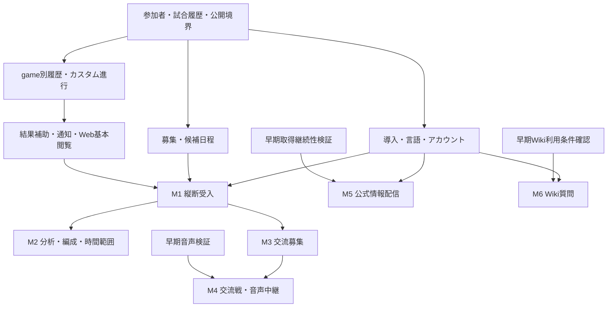

# ADR 0007: ヒアリング要件を基準とする段階的な開発

- Type: adr
- Status: accepted
- Summary: 合意要件、既存実装との差、実装順と完了判定を分け、普段の募集とカスタムを初期提供する。
- Read when: 機能のscope、実装順、データ公開境界、既存Issueの完了を判断するとき。
- Related: [実行計画 #158](https://github.com/akigami-net/ADTeemo/issues/158)
- Code: [現行schema](../../api/src/db/schema.ts), [現行command registry](../../bot/src/common/command_registry.ts)
- Tests: [既存custom flow](../../bot/src/commands/custom-game-flow.test.ts), [既存監視policy](../../tests/integration/watch_policy.integration.test.ts)
- Reviewed: 2026-11-19
- Verified: 2026-11-19、main c714912のcode・文書・open Issue/PRを照合。新要件の実装・外部サービス実運用は未検証。

## Context

既存実装に合わせたIssue分割では、ユーザーが望む通常募集、日時調整、長期分析、交流戦、情報配信を捉えきれていなかった。ヒアリングにより[合意要件](../../REQUIREMENTS.md)を再定義した。ここで採用したのは目標と進め方であり、将来機能を実装済みとは扱わない。

タスクの状態・受け入れchecklistはGitHub Issuesだけに置く。本書は長期的な依存理由とリリースの成果を保持し、Issueのopen/closed状態や進捗率を複製しない。

## Decision

### 最初に固める境界

1. Discord参加者identityとRiot accountは分ける。未連携の参加、代理入力、試合ごとのaccount選択を支える。代理入力はRSO認可ではない。
2. イベント全参加者、試合ごとの出場者、待機者、各試合のロール/サイド/account snapshotを分ける。既存イベント・戦績はmigrationで保持する。
3. 戦績の物理的な一元保存と閲覧・分析scopeを分ける。Xで見えないY内部試合はXの集計、均等化学習/特徴量、cache、Discord簡易表示にも混入させない。
4. 未取得と実値0、画像抽出の候補と確認済み値を分ける。収集時に出典・観測時点・欠損・試合同定を残し、後からの分析のために再取得不能なデータを捨てない。
5. Botの既存service認証をWebの利用者認証に使い回さない。Web API側で所属・共有範囲を検査する。現行の非公開service routeをそのまま公開しない。

これらを最初の設計・移行PRで扱い、その後の機能は縦に小さく実装する。大規模な全体書き換えや、未承認のRiot機能を待つ進め方を採らない。

### マイルストーンの成果

| マイルストーン                | 利用者ができること / 完了判定                                                                                                                                                                                                                                | 主な要件                                                                          |
| ----------------------------- | ------------------------------------------------------------------------------------------------------------------------------------------------------------------------------------------------------------------------------------------------------------ | --------------------------------------------------------------------------------- |
| M1 導入から普段の利用まで     | 既存選択/新規作成による導入、通常募集、クリックだけの日程回答、同一サーバーのカスタム、通知、結果保存、Webの基本閲覧が一通り動く。未連携者を含む12人で10人出場/2人待機→交代→次試合を行い、履歴を保持できる。画像/手入力補助、サーバー言語・Bot絵文字を含む。 | P、SET、ID、REC-01〜03/05、TIME-01〜03、CUS-01〜03、ACT、DATA-01/03/04、ACL、LANG |
| M2 分析と編成・日程調整の充実 | カスタムを中心とした長期の成長・対面・ビルド・相性をWeb/Discordで確認でき、偏りや欠損を示した編成候補を得られる。取得可能な過去試合の取込、Webの連続した空き時間調整ができる。                                                                               | AN、CUS-04、TIME-04、DATA-02                                                      |
| M3 交流先への募集             | 選んだ交流先へ募集し、各サーバーの投稿から参加・退出・日程回答が同一状態に反映される。                                                                                                                                                                       | REC-04、TIME-05の共通回答                                                         |
| M4 交流戦とVC中継             | 全体企画者と各サーバー代表が別々のチームを運営できる。共有スコアボード、前後のBot中継、停止・片方向pause、3者会議、独立した同時接続を確認する。                                                                                                              | CROSS、VOICE、ACL-02、TIME-05の陣営別成立判定                                     |
| M5 公式情報・プレビュー配信   | 公式記事と、指定Rioter本人の本文・画像・自己返信を根拠付きの日本語で配信し、訂正・補足を反映する。X APIへの課金なしで成立する。                                                                                                                              | NEWS                                                                              |
| M6 Wiki質問機能               | DiscordでLoL限定・Wikiのみを根拠に会話でき、出典提示、未記載・範囲外の処理、サーバー文体を満たす。                                                                                                                                                           | QA、LANGの再利用                                                                  |

M1の共通設定・通知基盤が整えばM5/M6は独立して進められる。番号順の直列実装を強制しない。M4の音声技術検証、M5の取得継続性、M6のWiki利用条件は早期に調査するが、これらをM1のリリース依存にしない。人員・稼働時間が未提示のため、根拠のない暦日締切は置かない。

### 実装順とPRの単位

- 最初のPR: 境界の設計、既存データへの影響、migrationと回帰例。現状のglobal rating案やevent固定rosterを新機能の既定仕様にしない。
- 次に設定・参加・日程・試合進行をそれぞれBot→API→一時DBまで通す小さいPRにする。1本で全M1を実装しない。
- 記録の型・scopeを確定してからWebをつなぐ。M2のグラフ実装前に、M1で取得可能なチャンピオン/ビルド/ロール等の履歴を保持する。
- 各PRは要件ID、対象Issue、利用シナリオ、検証、制限、migration/復旧方法を示す。現在利用可能なガイドは実装と同時に更新する。
- 外部試験は専用の検証用サーバー・アカウントで、必要な許可・接続範囲を整えてから行う。既存のproduction禁止規則を要件合意だけで解除しない。

### 2026-11-19の実装照合

以下はmain `c71491240c5d1068d8da4f82725dc2810132b6bb` の静的照合であり、将来の完了状況はIssuesで確認する。

| 領域                      | 再利用できる証拠                                                                                                                                                     | 合意要件との差                                                                                                 |
| ------------------------- | -------------------------------------------------------------------------------------------------------------------------------------------------------------------- | -------------------------------------------------------------------------------------------------------------- |
| 導入・言語                | [setup](../../bot/src/commands/setup-custom-game.ts)、[role作成](../../bot/src/commands/setup-roles.ts)、[messages](../../bot/src/messages.ts)                       | 設定は独立command、文体はprocess環境変数。選択/作成wizard、guild言語、application emoji運用が必要。            |
| account・監視             | [accounts](../../api/src/db/repositories/users.ts)、[監視policy](../adr/0006-account-monitoring-policy.md)                                                           | 複数accountと既定監視はある。未連携の全flow保証、代理登録、game別選択、閲覧scopeの契約が不足。                 |
| カスタム                  | [split-teams](../../bot/src/commands/split-teams.ts)、[event/game schema](../../api/src/db/schema.ts)、[flow tests](../../bot/src/commands/custom-game-flow.test.ts) | 各ロール2人・計10人固定でランダム配分。event固定rosterをgame別に分け、待機者・交代・再編成・段階UIを追加する。 |
| 戦績                      | [record-match](../../bot/src/commands/record-match.ts)、[整合性](../record-match-consistency.md)                                                                     | atomic/冪等保存は再利用。画像抽出、欠損と0の区別、参加者による代理確定、長期集計が不足。                       |
| 試合通知                  | [service](../../bot/src/features/match_tracking_service.ts)、[delivery](../integrations/match-notification-delivery.md)、[LP](../user/ranked-lp.md)                  | 通知・復旧基盤はある。モード別取得能力、長期データ、起動/更新/異常停止、#99の原現象の調査が残る。              |
| 通常募集・日程・Web       | [command registry](../../bot/src/common/command_registry.ts)、[workspace](../../deno.json)                                                                           | 通常募集・候補回答UI・Web workspaceは未提供。既存custom募集だけで充足としない。                                |
| 交流・中継・情報配信・Q&A | 同上                                                                                                                                                                 | 今回の機能は未提供。独立の実装・実現性確認を要する。                                                           |

### 受入の実例

M1では、初回導入のやり直し、4人の通常パーティへの1人参加/退出、文章入力なしの日程回答、未連携者入りの12人カスタム、試合間の2人交代、勝敗だけの保存、企画者不在時の出場者による確定を一連で確認する。再起動・古いボタン・重複クリック・Discord部分失敗でも二重参加/二重記録/無断の再抽選を起こさない。

公開境界は、AがX/Y両方に所属するfixtureで検証する。個人ランク通知は双方へ、Y内customはXの画面/API/集計/編成から除外、X対Yは当該試合の共有範囲のみ、退出後は過去記録を残して新規共有と閲覧を停止する。音声pauseは相手への通知が出ないことと、音声送受信の方向を別々に検証する。

## Consequences

[ADR 0006](./0006-account-monitoring-policy.md)の「カスタムはメインのみ」と旧構成文書の「全ギルド共通評価」を、将来設計の前提から外す。全登録accountの監視・本人opt-out・PUUID整合性等の既存保証は維持する。DBをグローバルに保存することは、非共有試合を横断利用する理由にならない。

旧[scope案](../proposals/project-scope.md)の「配信はGAS側のみ、Web未採用」と旧[custom案](../proposals/custom-game-flow.md)の採否待ちは、今回の要件により更新する。旧判断は履歴として残す。#154〜#157は採否を再質問するIssueから、合意済み成果を実装・検証するIssueへ再定義する。#49のPodman移行保留、#99の原因未特定は維持する。

## Rejected alternatives

- コードにない要望を「未採用」として落とすこと、またはドキュメントの採用だけで実装完了扱いすること。
- M1をカスタム専用または通常募集専用に縮め、もう一方を期限なく後回しにすること。
- 普通のロビーAPI/全員のRSO認証/追加デスクトップ常駐を必須にすること。
- 未確認APIを先に実装前提として固定すること、Xの有料APIや第三者転載を本人投稿の代替正本にすること。

## Enforcement

Issueの受け入れ条件を要件IDと対応付け、設計・fixture・Bot/API/DB縦断とWebの所属境界で検証する。実装変更は`deno task quality`、文書変更は既存の文書検証手順に従う。調査Issueは観測範囲・採用/代替判断・再確認条件を残して完了する。機能Issueはその機能の利用が成立して初めて閉じる。
