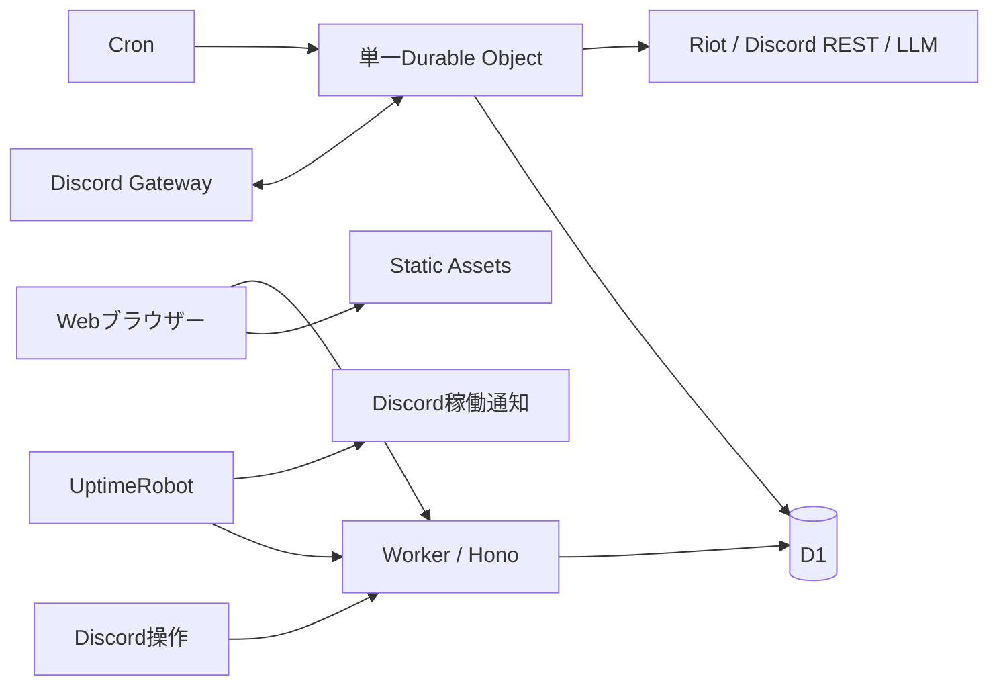

# ADR 0008: 追加費用なしのCloudflare配備

- Type: adr
- Status: accepted
- Summary: 通常機能をWorkers・D1・単一のDurable Objectへ移植し、無料枠の上限と音声中継の未充足を明示する。
- Read when: 本番配備、runtime/DB移植、運用監視、費用制御、音声中継の提供条件を変更するとき。
- Related: [全体管理 #158](https://github.com/akigami-net/ADTeemo/issues/158), [基盤 #159](https://github.com/akigami-net/ADTeemo/issues/159), [稼働通知 #164](https://github.com/akigami-net/ADTeemo/issues/164), [Web #166](https://github.com/akigami-net/ADTeemo/issues/166), [M1受入 #167](https://github.com/akigami-net/ADTeemo/issues/167), [音声 #172](https://github.com/akigami-net/ADTeemo/issues/172)
- Code: none（Cloudflareへの移植は未実装）。比較対象は[DB接続](../../api/src/db/index.ts), [Bot起動](../../bot/src/main.ts), [現行Compose](../../docker-compose.yml)。
- Tests: [runtime検証スクリプト](../research/fixtures/cloudflare-runtime-probe.mjs)。既存アプリ全体のCloudflare動作を保証するものではない。
- Reviewed: 2026-11-19
- Verified: 2026-11-19、公式資料とローカルworkerdで基本機構を確認。本番アカウント、Discord接続、日次使用量、音声中継は未検証。

## Context

[ADR 0007](./0007-product-requirements-baseline.md)の要件と進め方を補完する。配備には追加月額0円・新たなカード登録なし・常時稼働する所有サーバーなしという条件がある。既存のCloudflareアカウントを使う。無料枠を超えたら有料へ自動移行する構成にはしない。

現行のDenoプロセス、discord.js Client、file SQLite、Docker Composeを、そのままWorkersへ配置することはできない。配備設計の採用、実装完了、本番提供を別々に扱う。ここで選定を終え、独立した「配備先を調べるIssue」は作らず、具体的な移植・配備・受入を既存Issueへ反映する。[根拠と試験範囲](../research/zero-cost-deployment.md)を参照する。

## Decision

### 初期配備の構成

| 責務                                | 採用する配置                                                                                       |
| ----------------------------------- | -------------------------------------------------------------------------------------------------- |
| WebのHTML/JS/CSS                    | Workers Static Assets。提供されるHTTPSの`workers.dev`を使用し、独自ドメイン購入を必須にしない      |
| Discordのコマンド・ボタン受付       | HTTP InteractionsをWorkerで受信。生bodyの署名検証後、3秒以内に応答またはdefer                      |
| Web/API                             | Worker上のHono。利用者sessionとBot内部呼出しを分離し、全データ取得で所属・共有scopeを検査          |
| 所属変更・VC状態等のGatewayイベント | SQLite-backed Durable ObjectをBot全体で1個使用。外向きWebSocket、heartbeat、再接続を担当           |
| 期限・試合監視・通知の再送          | 同じDurable Objectが永続jobを処理。Cronは起動確認と期限到来jobへの入口。複数ギルドの処理をまとめる |
| 戦績・募集・設定・job・outbox       | D1を正本とする。初期は1 DB。DO内にはGatewayの復帰情報等だけを保持し、戦績の二重正本を作らない      |
| 異常停止の検出                      | UptimeRobot FreeのHTTPS監視とDiscord連携。BotとCloudflareの外から検知する                          |
| 画像抽出・翻訳・Wiki回答            | 外部LLM API。使用可能な無償枠または有効化済み付帯creditの範囲に制限する                            |

これは**音声を除く配備構成**であり、VOICE要件の代替ではない。VC移動はDiscord REST操作であり、音声送受信と分けて実装できる。

### 保存・同時更新・再起動

- Honoの契約、domain処理、message catalogを再利用し、runtime依存の`Deno.env`、process起動、file DB、Gateway接続をadapterへ分離する。既存のDiscord操作はRESTとHTTP interactionのadapterへ移す。discord.js Client全体の無修正移植を前提にしない。
- D1 adapterはDrizzleのD1対応とprepared statementを使用する。現在の`database.transaction(async tx => ...)`をそのまま通さず、操作ごとに条件付きSQLと`batch()`へ変換する。外部API待ちをDB transactionに含めない。
- 人数・状態の前提をSQL内で検査し、revision比較、unique制約、operation keyで競合と再送を扱う。関連行とoutboxは同一batchへ入れる。条件不成立はSQLエラーとは限らないため、変更件数・保存済み状態を確認して結果を返す。
- jobはD1の期限・状態・leaseで回復できるようにする。Gatewayのsession/sequenceは復帰可能な範囲で保存し、Resume不可なら再Identifyする。所属の完全同期が終わるまで監視配送を再開しない。古い接続の後発イベントは世代番号で拒否する。
- 全guildのGateway接続を1個のDOへまとめる。常駐DOをguildごとに増やさない。CPUの重い処理はDO内で小分けにし、通常Workerの10 ms枠へ画像処理や大きな集計を載せない。通知・外部APIのrate limitは永続queueで守る。

### 無料枠と保存容量

Freeを維持する。Workersの日次100,000 request、D1の日次読込5,000,000行/書込100,000行、初期DBの500 MB、DOの日次13,000 GB-s等を運用上限とする。D1の合計5 GBを1個のDBで使えるとは扱わない。index更新も書込量へ含まれる。

外向きWebSocketはhibernateしないため、128 MBのDOが1日稼働すると約1.1万GB-sを消費する。これは13,000 GB-s内という**机上計算**であり、実際のアカウントには他DO、旧版との重複、再接続の余裕が必要。2個のDOを常時動かす構成は採らない。必要なshard数や共有アカウントの他用途によって予算内に収まらなくなったら、自動課金せず追加導入を止めて条件を見直す。

保存量と日次消費を可視化し、上限の80%で運用者へ通知する。DB容量・書込余裕が不足した場合は過去試合の一括取込を先に停止し、次に自動収集を抑える。確定済み戦績を古さだけで削除しない。容量不足時の入力は成功と表示せず、exportと復旧手順を示す。無料枠を無期限・無制限の保存保証と説明しない。

原画像・音声の恒久保管を要件に足さない。結果画像はDiscord添付から一時処理し、確認済みの戦績と出典を保存する。画像URLの永続有効性には依存しない。R2や有料Vectorize等を初期配備の必須サービスに含めない。

### LLMの追加費用制御

既存の対話サービス契約を、そのままBot用API認証として使わない。API側で実際に付与されたcreditと利用条件を確認して有効化する。OpenAIの付帯API creditは候補にできるが、対象地域・アカウント・有効化・失効があるため、全利用者に付くとは仮定しない。Google側も開発者特典とCloud Billingの設定を別に扱う。

LLMはserver側でモデル・入出力上限・並列数・期間予算を制御する。自動チャージと有料枠へのfallbackを設定しない。有償残高と同じAPI組織を使う場合、grantが尽きてもAPIが継続することがあるため、providerの429だけを費用上限にしない。残額/有効期限が確認できない時も停止側へ倒す。画像抽出が使えない場合も手動の結果保存を維持し、翻訳・Q&Aは利用不可を明示する。

### 監視・復旧・配備

- `/health/ready`はGatewayの最新ACK時刻、所属同期、期限jobの進行、D1読書きの可否を基に200/503を返す。内部情報やメンバー情報を公開しない。Workerの静的な200だけでBot稼働と判定しない。
- UptimeRobot Freeは5分間隔で外から確認し、既定の運用通知先へ停止/復帰を通知する。即時通知やSLAを約束しない。計画停止・更新は配備処理で事前通知し、異常停止は外部監視に任せる。Discord全体の障害ではDiscord宛の即時配送も保証できない。
- 初期のDB復旧はD1 Time Travelの7日範囲を使用する。schema変更前と運用者の定期作業でSQL exportを取得し、暗号化して管理者の手元に保存する。公開GitHubへ戦績dumpを置かない。独立した自動backupを実装済みとは扱わず、restore試験までをM1受入に含める。
- Wrangler設定、DB migration、必要なsecret名、手動の初回配備とrollback手順をrepoへ追加する。`main`のCI成功を条件とし、本番用GitHub Environmentにsecretを分離する。PR previewは本番Bot token/DBを使わず、同じtokenのGatewayを二重起動しない。
- 自動CDは初回の配備・復旧確認後に有効化する。アカウント作成、secret登録、本番migration、Discordコマンド登録、実際の配備は別の実行操作であり、本ADR採用を実施済みとみなさない。

### 音声中継についての結論

Discord音声はUDPとDAVE対応を要する。Workersの`node:dgram`は非機能stubであり、通常の`@discordjs/voice`をこの構成で動かせない。Cloudflare Realtime TURNの無料転送枠は、Botの音声受信・復号・混合・再暗号化・送信を実行するサーバーの代わりにはならない。

WorkersからTURNへ接続する専用transportは、通常の音声実装の移植とは異なる。現時点で採用を裏付けるDiscord/DAVE実接続の証拠がないため、無料で提供可能とは記載しない。無料のcontainer候補も、カード条件・休止・実行制限を含め確実な配備先として採用できていない。**現在確定した構成ではM4のVOICEを提供できず、全要件を同じ条件で満たす配備先の確定には至っていない。**

VOICE-01〜04は維持する。#172へこの具体的な制約を反映し、UDP音声処理を継続できる実行先と費用条件が成立するまで、M4を提供可能/完了としない。M1のVC移動・カスタム運営やM3の交流募集は実装を進められる。勝手に「全員が別サーバーへ移動する」要件へ置き換えない。

## Consequences

常駐VMを契約せず初期機能を提供する代わりに、runtime/DB/Discord adapterの移植がM1に必要となる。既存Docker環境は移行前の開発・回帰確認用として残し、Cloudflare用手順が動く前にREADMEを配備済みへ書き換えない。

#159でD1・migration・原子性、#164でGateway/永続job/稼働監視、#166でStatic Assets/Hono/OAuthと配備設定、#167で実環境の受入・無料枠・復旧を扱う。順序はDB契約→Bot/API移植→Web接続→専用環境配備→M1受入。ADR 0007の機能別PR単位と公開境界を維持する。

## Rejected alternatives

- 無料枠付きVMを、カード登録不要・空き容量保証ありと説明すること。
- WorkersへDocker/file SQLite/discord.js常駐プロセスを無変更で置くこと。
- 休止する無料Webサーバーを、非HTTPイベントも受け続ける常駐Botの保証にすること。
- TURNだけでDiscord音声処理が完成するとみなすこと、未検証のtransportを採用済みとすること。
- AIの対話画面・個人cookieをBotから操作して、API枠を代用すること。
- Actions等を長時間常駐させたり、複数無料アカウントへ分散したりして無料枠を回避すること。

## Enforcement

実装PRでは既存qualityに加え、workerd上で署名、D1の同時更新とrollback、Gateway切断・復帰、重複job、所属不明時の配送停止を確認する。専用Cloudflare/Discord環境では48時間の使用量、10人規模の操作、再配備・DB復元・停止通知を確認し、無料枠超過/credit失効時に追加課金せず処理を制限できることをM1受入に含める。

ローカルruntime試験を、本番のDiscord通信・CPU課金・可用性の証明として使わない。実環境の受入は選定をやり直す調査Issueではなく、具体的な実装の検収とする。
