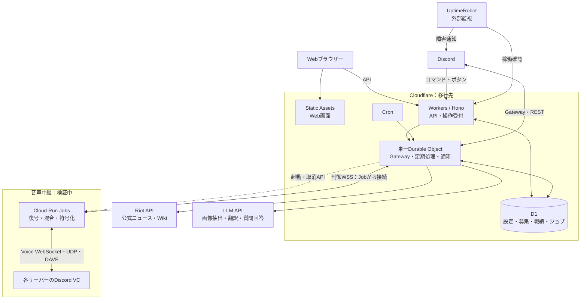

# システム構成

- Type: integration
- Status: current
- Summary: 全体構成、移行先と現行実装の違い、データと処理の責務を示す。
- Read when: システム全体やworkspace間の関係を確認するとき。
- Related: [配備方針](../adr/0008-cloudflare-deployment.md), [全体管理 #158](https://github.com/akigami-net/ADTeemo/issues/158)
- Code: [API](../../api/src/app.ts), [Bot](../../bot/src/main.ts), [schema](../../api/src/db/schema.ts)
- Tests: [Bot boundary](../../bot/check-runtime-boundary.test.ts), [repository](../../api/src/db/repositories.integration.test.ts)
- Reviewed: 2026-11-25
- Verified: 現行構成は2026-09-29のcode reviewとSQLite試験。移行先の根拠は配備・音声の調査文書を参照。

## 全体構成

Cloudflareを通常機能の移行先とし、音声中継にはCloud Run Jobsを検討している。以下は移行後の構成図で、現在の実装は後述する。

音声はDiscordとJobの間を流れ、Cloudflareには制御情報だけを渡す。1会議を1 Jobで処理し、独立した会議は別々に実行する。詳細は[音声中継案](../proposals/cloud-run-voice-relay.md)、採用理由は[ADR 0008](../adr/0008-cloudflare-deployment.md)、確認した仕様と実測値は[配備基盤の調査](../research/deployment-platforms.md)・[音声の検証](../research/cloud-run-voice-relay.md)に置く。

## 現行実装

現在はDenoのBotとHono APIを別プロセスで動かし、APIがSQLiteを管理する。Cloudflareへの移植、Webでの戦績閲覧・分析、音声中継は未実装。

| 境界        | 責務                                          |
| ----------- | --------------------------------------------- |
| `bot/`      | Discord操作の受付、表示、VC移動、通知         |
| `api/`      | DB更新、Riot API・静的データ・任意のOP.GG連携 |
| `messages/` | 言語・テーマ別のメッセージ                    |

実行環境・依存は各workspaceの`deno.json`、起動・配備手順は[開発者ガイド](../../CONTRIBUTING.md)を参照する。

## データ所有境界

- Discord identity、Riot account、戦績を一元保存し、メインロールと監視設定はguild単位で扱う。共有DBに保存した試合でも、閲覧・分析・編成への利用は[公開範囲](../../REQUIREMENTS.md#閲覧分析保持)に従う。
- 募集channel、VC、Discord resource、進行状態はeventが所有する。戦績はeventとgame番号にひも付き、記録時のPUUIDを保持する。
- 現行の試合監視は全登録account、カスタムゲームはメインaccountを使う。[ADR 0006](../adr/0006-account-monitoring-policy.md)を参照する。

## SQLite操作の直列化

SQLiteの同時writerは1つに限られるため、[DB action](../../api/src/db/actions.ts)は`Database`インスタンス単位の共通queueを通す。取得処理を含む公開actionを直列化し、transaction内のSQLは再enqueueしない。外部HTTP待ちをqueue内へ含めない。

この排他はprocess内だけで有効。複数API processや独立したDB接続から同じファイルへ書き込む構成では、書き込み所有者の再設計が必要になる。migrationも稼働中のAPIと競合させない。[並行更新・rollback・再送のテスト](../../api/src/db/writes.integration.test.ts)で保証する。

## Riot共有queue

Riot呼び出しはAPI process内の共有queueへ集約する。routing先・method別のrate limitとRetry-Afterを守り、送信可能な要求をFIFOで処理する。retry対象はtimeout・network error・429・5xxに限定する。

queueとBotのsaga排他はprocess内に閉じるため、現行構成はAPI/Botとも単一processで運用する。待機時間・試行回数・deadlineは[実装](../../api/src/riot_api.ts)と[テスト](../../api/src/riot_api_queue.test.ts)を参照する。

## 関連する設計

- 認証とログ：[サービス認証](../adr/0001-bot-service-authentication.md)、[ログの信頼境界](../adr/0002-structured-logging-trust-boundary.md)
- 更新と復旧：[イベント整合性](../custom-game-event-consistency.md)、[戦績整合性](../record-match-consistency.md)、[通知delivery](./match-notification-delivery.md)
- APIと表示：[APIエラー契約](../api-error-contract.md)、[メッセージ編集](../../messages/README.md)
