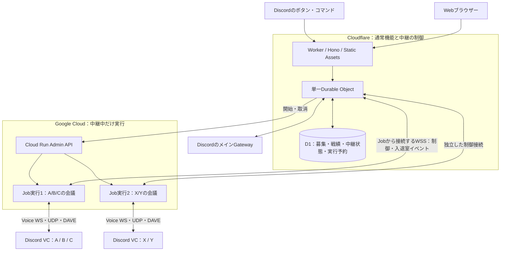

# Cloud Run JobsによるDiscord音声中継の検証

- Type: research
- Status: current
- Summary: Cloudflareで制御し、必要な間だけCloud Run Jobsで音声を扱う候補について、公開仕様・ローカル試験・実機未検証の境界を記録する。
- Read when: 音声中継の配備、起動停止、同時接続、Google Cloudの費用条件を判断するとき。
- Related: [音声 #172](https://github.com/akigami-net/ADTeemo/issues/172), [全体 #158](https://github.com/akigami-net/ADTeemo/issues/158), [ADR 0008](../adr/0008-zero-cost-cloudflare-deployment.md)
- Code: none（製品への音声中継・Cloud Run launcherは未実装）。[検証用probe](./fixtures/cloud-run-voice/probe.mjs)は独立した実験コード。
- Tests: [probe](./fixtures/cloud-run-voice/probe.mjs), [固定依存](./fixtures/cloud-run-voice/package-lock.json), [検証用Dockerfile](./fixtures/cloud-run-voice/Dockerfile)。
- Reviewed: 2026-11-25
- Verified: 2026-11-24に公開仕様・Node/Linuxでの11項目を確認。Cloud Runへの配備、Discord実接続、実課金は未検証。
- Observed: 2026-11-24。資料の公開・更新日と本書の確認日を区別する。

本書はnon-normative。**Cloud Run Jobsは実機試験へ進める候補であり、正式採用・VOICE要件の実装完了・追加請求0円の保証ではない。** 通常機能のCloudflare構成はADR 0008を維持する。テスト環境の実ID、接続情報、個人の契約情報は本書・fixture・Issue・PRへ記録しない。

## 結論と構成

Jobsは外向きTCP/UDPとLinuxのネイティブライブラリを扱える。HTTPリクエストを保持する必要がなく、音声中継の開始から終了までを1回の実行として扱える。ただし、Discord固有のUDP往復・DAVE鍵交換・音声受信は実機試験を通していない。



音声はDiscordとJobの間だけを通る。Worker/DO/D1へ音声を転送・保存しない。JobはNodeと`@discordjs/voice`で受信・復号・Opus decode・混合・encode・送信を担当する。DAVEは各VCとの区間で終端し再暗号化する。サーバー間をまたぐ単一のE2EE経路ではなく、Botは音声を復号する。

メインGatewayは全Botで1接続に集約する。Jobごとに同じBot tokenで一般のDiscord Clientへログインし直さない。`@discordjs/voice`のcustom adapterを使い、JobからのVoice State UpdateをDO経由で送信し、DOが受け取った`VOICE_STATE_UPDATE`・`VOICE_SERVER_UPDATE`を該当Jobへ渡す。Bot tokenはCloudflare側に保持する。Jobへ渡すvoice token等も秘密として扱い、ログへ出さない。

## 公開仕様から確認したこと

| 論点           | 確認した事実と設計への影響                                                                                                                                                    |
| -------------- | ----------------------------------------------------------------------------------------------------------------------------------------------------------------------------- |
| UDP            | Jobsの外向き通信はTCP/UDP。Discordは別のVoice WebSocketとUDPを使い、IP discoveryを行う。Jobから開始したUDPの返信が実際に届くことは別途実測が必要。公開UDP待受の設置とは異なる |
| 実行時間       | CPU Jobは既定10分、上限168時間。検証設定では明示的に1時間へ制限。上限時間は無停止保証ではない                                                                                 |
| 課金時間       | 起動から終了までを課金し、最低1分。話していない待機中・一時停止中も課金対象                                                                                                   |
| 終了           | 正常完了はexit 0。timeout時はSIGTERM後10秒でSIGKILL。退室・転送停止を先に行い、終了ログの送信を待ち続けない                                                                   |
| 再試行         | max retriesは0〜10。音声Jobでは自動再試行を0とし、再接続は認可と残時間を確認した明示的な状態遷移にする                                                                        |
| 並列数         | `parallelism`は1回のexecution内のtask数の制限。別々に発行したexecution全体の上限にはならない                                                                                  |
| メンテナンス   | CPU Jobの移行ではSIGTSTP/SIGCONTを扱える。VPC接続は移行時に切れる。また一般に外向き接続のresetがあり得るため、public egressでも無切断を保証しない                             |
| 受信ライブラリ | `@discordjs/voice`は音声受信の安定性を保証していない。現行Discord/DAVEとの実接続を採用条件に残す                                                                              |

出典: [Cloud Runのネットワーク](https://docs.cloud.google.com/run/docs/securing/security)、[task timeout・maintenance](https://docs.cloud.google.com/run/docs/configuring/task-timeout)、[container契約](https://docs.cloud.google.com/run/docs/container-contract)、[retry](https://docs.cloud.google.com/run/docs/configuring/max-retries)、[parallelism](https://docs.cloud.google.com/run/docs/configuring/parallelism)、[Discord voice](https://docs.discord.com/developers/topics/voice-connections)、[voice library](https://github.com/discordjs/discord.js/tree/main/packages/voice)。

## 1回の中継をどう動かすか

1. Workerが操作権限・参加サーバーの合意・集合先を確認する。DOが中継IDと世代番号を作り、D1へguildごとの排他予約、起動予約、期限を保存する。
2. 起動前に同時実行枠と残り実行時間を予約し、Jobs APIを呼ぶ。1会議につき1 execution / 1 task。3サーバーは1つのJob、独立した2組は2つのJobになる。
3. JobはCloudflareへ外向きWSSを張る。公開HTTPサーバーや定期的なHTTPアクセスによる延命は不要。認証・世代・executionの所有権を確認してからvoice情報を渡す。
4. すべての対象VCの接続が成立してから「中継中」と表示する。起動待ち・一部の接続失敗を成功表示にしない。必要なら準備時刻より前に起動するが、その待機分も予算へ含める。
5. 送信先ごとに「そのguild以外の音声」を混合する。Bot自身の音声は入力から除外。pauseは自guildの送信だけを止め、受信を維持する。pauseを相手向けの状態・通知へ含めないが、無音から推測されることまでは防げない。
6. 2者の片側停止では全体を止める。3者から1者停止ではそのguildを除き、残り2者を継続する。制御断では即座に転送を停止し、再認証・状態確認前に再開しない。
7. 終了時は音声queueを破棄し、Gatewayへ退室を指示し、Voice WS/UDPを閉じてexit 0。反応しないexecutionは取消APIで止める。取消要求が通っただけで終了扱いにせず、終了状態を照合して予約を解放する。

同じBotは1guild内の複数VCへ同時参加できない。同一guildを別の中継へ重複予約させない。ライブラリのconnection groupを変えることでDiscord側の制約を回避できるとは考えない。

### 二重起動と認証

Jobs APIのrun要求には公開schema上、重複排除用のrequest IDがない。応答を失った時に無条件で再実行しない。operation/execution IDと起動予約を照合し、Jobがclaimするleaseは世代・executionと結び付ける。所有権を失ったJobや遅れて届いた前世代のイベントには入退室操作も許可しない。重複Jobを即時終了させても最低課金が発生し得る。

Cloudflareの起動用identityとJobのruntime service accountを分離する。起動用には対象Jobに限った`roles/run.jobsExecutorWithOverrides`相当の実行・取消権限を与え、状態照合に必要なget/listも別途限定する。Ownerを付与しない。初期案は専用service accountの認証をWorker secretで管理する方式。鍵をrepo・client・Jobへ配らない。Jobの制御接続はGoogle発行identity tokenのaudience・issuer・subjectと短期の中継権限を検証する設計とし、この認証経路はまだ実装・検証していない。

出典: [jobs.runのschema](https://docs.cloud.google.com/run/docs/reference/rest/v2/projects.locations.jobs/run)、[IAM roles](https://docs.cloud.google.com/run/docs/reference/iam/roles)。

## 検証設定と費用

| 項目     | 初期の実機検証に使う設定案                                                         |
| -------- | ---------------------------------------------------------------------------------- |
| region   | 東京 `asia-northeast1`                                                             |
| runtime  | Node 24.19.0 / Linux amd64、native OpusとDAVE                                      |
| task     | 1 CPU、512 MiB、taskCount 1、parallelism 1                                         |
| 上限     | task timeout 3,600秒、maxRetries 0、DO側で同時executionを最大2に制限               |
| 通信     | 通常のpublic egress。VPC connector・Cloud NAT・公開HTTP endpointは初期必須にしない |
| メディア | 48 kHz / 20 ms、guildごとに混合したOpusを1本送信。初期試算は64 kbps                |
| 保存     | 音声はメモリ上だけ。永続disk、録音保存、GPUなし                                    |

これは検証用の値であり、製品の人数・利用時間要件を変更する決定ではない。512 MiBの適否は実接続時のRSSとDAVE負荷を含めて再確認する。

公開のTier 1単価はCPU $0.000018/vCPU秒、RAM $0.000002/GiB秒。1 CPU・512 MiBで合計10 job時間なら、無料枠・creditを適用する前のcomputeは**$0.684**。2会議を1時間同時に動かすと2 job時間になる。無料枠は課金アカウント合計でCPU 240,000秒・RAM 450,000 GiB秒/月であり、他プロジェクトと共有する。region/SKUは配備時に照合する。

外向き転送、image保存/build、ログ等はこのcompute試算に含まれない。3guildへ64 kbpsずつ送ると10時間でpayloadだけで約0.805 GiB。UDP/RTP/DAVE等のoverheadと制御通信が加算される。Cloud Runの無料ネットワーク枠を東京のDiscord通信にも適用できると仮定しない。転送先に応じたPremium Tier料金を見積もる。imageは同じregionに置き、古いimageを削除し、保存料を別サービスとして監視する。

出典: [Cloud Run pricing](https://cloud.google.com/run/pricing)、[network pricing](https://cloud.google.com/vpc/network-pricing)、[Artifact Registry pricing](https://cloud.google.com/artifact-registry/pricing)。

### Google AIプラン特典と追加請求の境界

公開特典としてGoogle AI Proには月$10のGoogle Cloud developer creditがある。対象は適格なGoogle Cloud製品で、Gemini専用ではない。Developer Program側で有効化し、Cloud Billingへ適用する必要がある。月次creditの付与日は特典を初回有効化した日が基準で、有効期限は付与から1年。個別アカウントの付与可否・残額・適用先は未検証であり、自動的に利用可能とは扱わない。[公式特典FAQ](https://developers.google.com/profile/help/benefits)

Cloud Billingには既存のGoogle payments profileを選択する経路があるが、新たな確認や支払手段の登録を必ず避けられるとは保証できない。Google Oneの契約だけではCloud Runの請求先設定は完了しない。[Billing作成手順](https://docs.cloud.google.com/billing/docs/how-to/create-billing-account)

Cloud Runには現在spend capがある。ただし1 project・1 service・暦月単位で、creditや割引を差し引く前の推定額を使う。停止には遅延があり、超過分は請求され得る。実行中のJobを即時終了させる仕組みとして頼らず、他サービスの保存・転送料も別に扱う。**creditとspend capだけでは追加請求0円を保証できない。** [spend capの仕様と制限](https://docs.cloud.google.com/billing/docs/how-to/budgets-spend-caps)

候補を進める場合は、creditの実適用確認、同時実行枠、起動前の最大実行時間予約、timeout、再試行0、失効時の新規起動停止を組み合わせる。例えば月10 job時間なら上記のcompute見込みになるが、これは請求上のhard capではない。OPS-01の費用条件を満たしたと判定せず、追加請求があり得る状態で自動配備しない。

## ローカルで実施した検証

Node 24.19.0 / Linux x64 / AMD EPYC 9V45で、`@discordjs/voice` 0.19.2、`@discordjs/opus` 0.11.0、lockfile内の`@snazzah/davey` 0.1.12を使用した。アプリのDeno依存へは追加していない。

| 対象                         | 観測した結果                                                                                               | 証明していないこと                                |
| ---------------------------- | ---------------------------------------------------------------------------------------------------------- | ------------------------------------------------- |
| 振り分けモデル7項目          | 3guildのmix-minus、送信のみpause、重複guild拒否、3→2継続、2者終了、独立2組と自己音声除外、制御断停止が成功 | 製品UI、実際のDiscord配送、DO/D1の排他・lease実装 |
| 実ライブラリのcustom adapter | join/leaveのGateway payloadを捕捉し、destroy時の退室とadapter破棄を確認                                    | Cloudflareをまたいだイベント配送・本物の接続      |
| native DAVE                  | protocol 1のsession作成とkey package生成に成功。ready=falseを確認                                          | MLSの参加完了、暗号化メディアの相互運用           |
| 実UDP                        | loopbackでOpus packet送受信・decodeに成功                                                                  | Cloud RunからDiscordへのIP discovery/NAT往復      |
| SIGTERM                      | 実子プロセスがUDP socketとtimerを閉じ、約5.56 msで自然終了                                                 | Cloud Runの取消、実Voice接続中の停止              |

計11項目。ルーティングモデルを試して成功しても、音声中継機能を提供済みとはしない。

合成PCMの入力packetを計測前に用意し、話者ごとに別のOpus decoder、送信先ごとに別のencoderを使った。各ケースで30秒相当の1,500 frameをdecode→mix→encodeした。全員が同時に発話する条件、20 ms/frame、出力64 kbpsで測った単発のmicrobenchmarkである。

| ケース          | 同時入力数 | 1秒分の音声に使ったCPU時間 | frame処理p95 / p99 | 計測後RSS  |
| --------------- | ---------- | -------------------------- | ------------------ | ---------- |
| A↔B、各5人      | 10         | 31.47 ms                   | 0.72 / 0.89 ms     | 96.09 MiB  |
| A/B/C、各5人    | 15         | 43.76 ms                   | 0.97 / 1.27 ms     | 107.96 MiB |
| A↔BとC↔D、各5人 | 20         | 51.89 ms                   | 1.23 / 1.43 ms     | 112.09 MiB |

host上のpeak RSSは112.21 MiB。2組ケースは同一probeプロセス内での分離・負荷確認であり、本番案の「2 executions」を実測したものではない。Cloud RunのCPU性能、通信遅延・jitter・packet loss、実音声品質、DAVEの暗号処理コストを含まないため、この数値から本番の人数上限を確定しない。

### 再現方法

fixtureだけで動き、Bot tokenやguild IDを入力しない。ソース中のsnowflakeは固定のダミー値で、Discordへ接続しない。

```sh
cd docs/research/fixtures/cloud-run-voice
npm ci
node probe.mjs
docker build -t adteemo-cloud-run-voice-probe .
docker run --rm --network=none --cpus=1 --memory=512m --memory-swap=512m --read-only --cap-drop=ALL --pids-limit=64 adteemo-cloud-run-voice-probe
```

Dockerfileは検証用probeを終了まで実行するimageであり、配備すれば音声中継Botになるものではない。本検証環境ではimage内のnpm依存取得がnetwork timeoutとなった。hostで取得済みの固定依存を同じbase imageへコピーする別手順ではimage作成まで成功したが、制限付きコンテナ実行の完了記録は得られていない。上の性能表はhostでの測定に限り、1 CPU・512 MiB制限での成功とは扱わない。

## 実機で残る確認と進め方

Cloud Run/Discordへの実接続・変更は行っていない。新しい調査Issueは作らず、上記の確認済み結果を#172へ反映し、次の境界を同Issueの完了条件として維持する。

| 境界               | 実施する確認と判定                                                                                                                     |
| ------------------ | -------------------------------------------------------------------------------------------------------------------------------------- |
| Cloud Runのruntime | 同じ固定imageでprobeを実行し、終了コード・RSS・task timeout・取消後の課金時間を記録                                                    |
| Discord/DAVE       | 専用の複数guildでIP discovery、DAVE protocol 1の鍵交換、実ユーザーの発話受信と再生を確認。1guildだけではサーバー間中継の証明にならない |
| 操作と分離         | A↔B、A/B/C、独立2組、pause、片側停止、3→2継続を実際のVCで確認。既存の通話へ無断で接続しない                                            |
| 障害と二重起動     | Job起動応答の喪失、DO再起動、古い世代の遅延イベント、制御断・SIGTERM・timeout・cancelで転送が残らず、同一guildへ競合参加しない         |
| 品質と費用         | 起動待ち、往復遅延、dropout、CPU/RSS、転送量、実行時間、credit適用を測る。少なくとも各ケースの連続60分試験を通してから実用可否を判断   |

実機試験へ進む順序は、課金・credit条件の確認→非音声probeのCloud Run実行→制御adapterの実装→2guildでのDAVE実音声→3guild・独立2組・障害試験。採用時に後続ADRで運用上限と費用条件を決める。無料枠、credit、IAM、Jobsの通信仕様、Discord/DAVE、voiceライブラリの更新時は再確認する。
